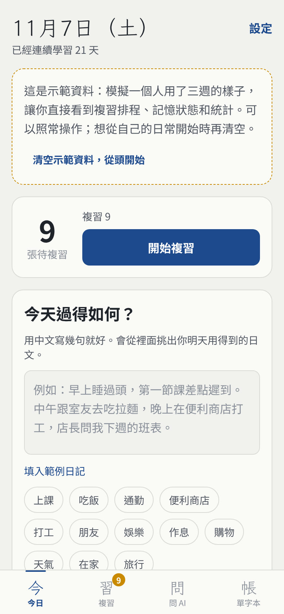
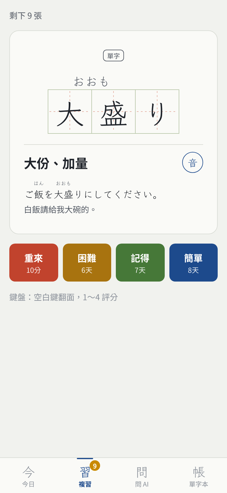
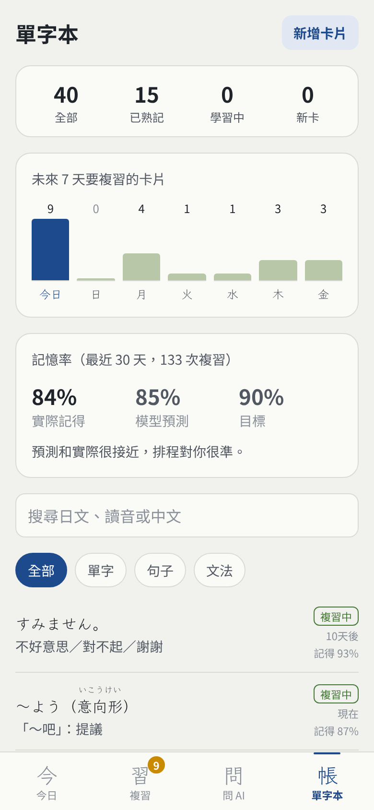
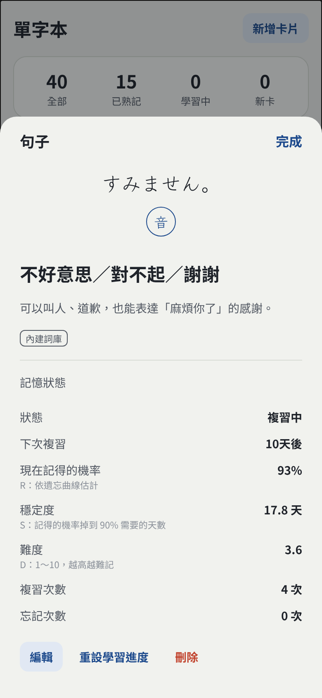
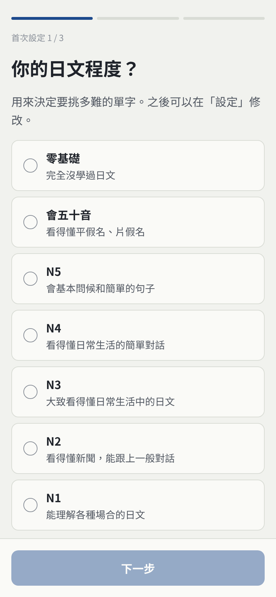
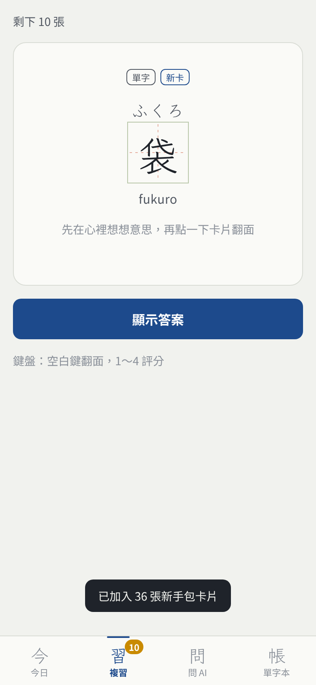
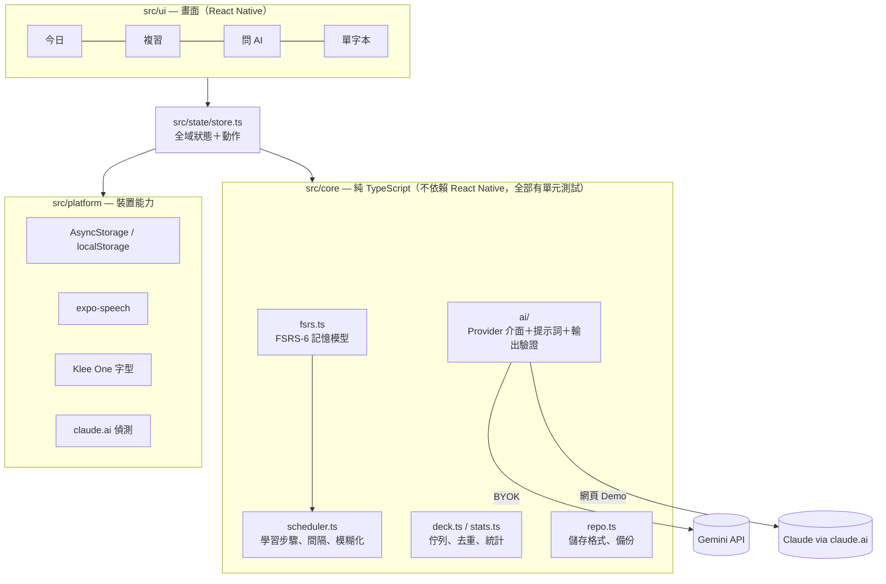

# Hibi 日々 — 從你的日常學日文

寫下今天發生的事，AI 從裡面挑出你明天就用得到的日文；再用 FSRS 記憶演算法，在你快要忘記的時候提醒你複習。

- 手機 App：Expo（React Native），iOS／Android 用 Expo Go 就能跑
- 線上 Demo：https://claude.ai/artifact/6A7rfnX9Qc1TANyhzVzNAW （打開就有「模擬使用三週」的示範資料）

<p>
  
  
  
  
</p>
<p>
  
  
</p>

## 為什麼做這個

背單字 App 的單字表是別人決定的，但最容易記住的，是「今天自己真的想說、卻說不出來」的那句話。
Hibi 把學習材料的來源換成使用者自己的生活：

1. **寫下今天**：用中文寫幾句就好（「早上睡過頭，第一節課差點遲到」）。
2. **AI 挑卡**：挑出 4～6 個單字、2～3 句實用句、0～1 個文法，例句都跟你今天的經歷有關，還會把日記翻成日文。
3. **間隔複習**：FSRS-6 演算法依照每張卡的「穩定度」與「難度」，算出記得機率降到 90% 的那一天再讓它出現。

## 功能

| 分頁 | 內容 |
| --- | --- |
| 首次設定 | 選程度（零基礎、會五十音、N5～N1）、學習目的、興趣；AI 推薦和新手包會依此調整 |
| 今日 | 待複習數量、連續學習天數、寫日記 → AI 推薦卡片（可勾選加入） |
| 複習 | 練習格（ます目）單字卡、翻面後淡入讀音（初學者一開始就顯示讀音和羅馬拼音）；四個評分按鈕預先顯示「下次多久後出現」；網頁版支援鍵盤；可復原 |
| 問 AI | 隨時問日文問題，回答裡值得記的內容一鍵整理成卡片 |
| 單字本 | 搜尋與篩選、未來 7 天複習量、**實際記憶率 vs. 模型預測**、每張卡的 R／S／D 記憶狀態 |
| 設定 | AI 服務（Gemini／Claude／離線示範）、目標記憶率、每日新卡數、程度／目的／興趣、發音速度、備份與還原 |

另外：日文發音（裝置內建語音，不需網路）、深色模式、日文字形正確的教科書體字型、初學者的羅馬拼音（助詞「は」會正確念成 wa）。

## 快速開始

需要 Node.js 20 以上。

```bash
cd hibi
npm install
npx expo start
```

手機安裝 **Expo Go**（App Store／Google Play），跟電腦連同一個 Wi-Fi，掃終端機上的 QR code 就能開啟。
在電腦上按 `w` 會開網頁版。

AI 功能（選用）：到 [Google AI Studio](https://aistudio.google.com/apikey) 免費申請 Gemini API Key，貼到 App 的「設定」。
沒有金鑰也能用：會自動切到「離線示範」，從內建的 116 項生活詞庫挑卡。

## 開發紀錄

| 時間 | 內容 |
| --- | --- |
| 2026 年 10 月 | 第一版原型 japanessapp：Expo Router 骨架、首次設定、Supabase 匿名登入與 profiles 資料表（RLS）。保留在最早的三個 commit（到 `9ea1536` 為止） |
| 2026 年 11 月 | 改寫成 Hibi：FSRS 複習、日記挑卡、問 AI、網頁 Demo；移植原型的首次設定與資料表定義 |

每次 push，GitHub Actions 會自動跑型別檢查和全部測試（`.github/workflows/ci.yml`）。

## 架構



```
src/
  core/        純邏輯：fsrs、scheduler、deck、stats、ruby（假名標註）、romaji、profile（學習者設定）、repo、sim、ai/、data/（詞庫）
  platform/    AsyncStorage、語音、字型（.web.ts 為網頁版）、claude.ai 偵測
  state/       store.ts
  ui/          theme、components（RubyText、MasuWord…）、screens
scripts/       網頁 Demo 打包、端對端測試、字型子集化
supabase/      雲端資料表定義（profiles＋RLS，下一階段才會接上）
docs/          產品規劃、導讀、口試問答、截圖
```

## 設計決策

| 決策 | 理由 |
| --- | --- |
| 排程用 **FSRS-6**，不用 SM-2 | Anki 自 23.10 版起內建 FSRS；在開源的 srs-benchmark 上，FSRS 對「會不會記得」的預測誤差（log loss）明顯低於 SM-2 |
| 自己實作 FSRS，再用 **ts-fsrs 當參考答案做對照測試** | 2,000 組隨機複習序列、上萬個步驟逐位比對，確定公式沒寫錯，也確定自己讀懂了 |
| 核心邏輯是**純 TypeScript** | 不需要模擬器就能在 Node 上測試；以後要搬到後端或其他平台也不用改 |
| AI 用 **Provider 介面** | 畫面不知道背後是 Gemini、Claude 還是離線示範；換模型只要多寫一個 provider |
| 讀音格式 **`{漢字\|かな}`** | 一個正規表示式就能解析，LLM 照範例就能穩定產生，同一份資料推導出純文字、全假名、分段標註三種形式 |
| 內建**日文字型**（子集化到 3.7MB） | 同一個 Unicode 漢字在中文、日文字型裡字形不同（漢字統一），台灣手機預設會用中文字形顯示日文 |
| 學習日以**凌晨 4 點**分界 | 晚上 11 點和凌晨 1 點的複習算同一天，不會被誤算成「隔了一天」 |
| 複習紀錄**按月份分段**儲存 | Android 的 AsyncStorage 單筆超過約 2MB 會讀不出來，紀錄會隨使用一直增加 |
| API Key 只存在裝置、**備份不匯出** | 備份檔可能被分享；正式上架應改成經由自己的後端呼叫 |
| 不用 Expo Router | 網頁版要打包成單一 HTML 發布在 claude.ai，那裡不能用路徑式網址 |
| 羅馬拼音**自己寫規則，用形態素分析器當參考答案** | 助詞「は」念 wa、「へ」念 e，光看假名分不出來；kuromoji 的辭典壓縮後就有 18MB，放不進 App，所以寫輕量規則，再用 kuromoji 的詞性結果逐句比對整個內建詞庫 |

## 測試

```bash
npm test             # 117 個單元測試
npm run typecheck
npm run demo:build   # 網頁版 → dist-demo/index.html
npm run demo:smoke   # 無頭 Chrome 走過 11 個主要流程並截圖（Windows 先設定 CHROME_PATH）
```

- **FSRS 對照測試**：與開源參考實作 ts-fsrs 6.0.0 逐步比對穩定度、難度、間隔、可提取率，兩種模式各 2,000 組序列
- **性質測試**：經過 S 天後可提取率剛好 90%、目標記憶率越高間隔越短、評「簡單」的穩定度成長大於「記得」……
- **內建詞庫讀音檢查**：用 kuromoji（日文形態素分析器）自動比對 116 項的人工讀音標註；分析器讀錯的 15 處經人工確認後列入白名單並註明理由
- **羅馬拼音檢查**：同一個分析器依詞性把助詞「は／へ」換成「わ／え」當參考答案，比對內建詞庫一百多句的羅馬拼音
- **AI 層**：用假的 fetch 測試 Gemini 請求格式、錯誤分類（金鑰無效、額度用完、找不到模型、斷線）、輸出格式容錯

## 限制與下一步

- **個人化參數**：目前用 FSRS 預設參數。累積足夠的複習紀錄後，可以用自己的資料訓練參數，並用 log loss 比較訓練前後
- **真人資料的評估**：示範資料是模擬學習者產生的，「實際記憶率接近預測」在模擬裡是必然結果，不能當成證據；需要真實使用者的紀錄做校準分析
- **推薦品質的評估**：AI 挑的卡片，使用者採納了幾成？採納的卡片之後記得比較好嗎？
- **羅馬拼音的助詞判斷是規則式的**：內建詞庫全部對過，但 AI 產生的新句子偶爾可能把「は」念錯
- **還沒做的功能**（詳見 [產品規劃](docs/產品規劃.md)）：雲端同步與伺服器端 AI（Supabase）、拍照／截圖學、漢字陷阱提醒（勉強、手紙）、用學過的字生成每日短文、生活日文覆蓋率

## 文件

- [docs/產品規劃.md](docs/產品規劃.md)：產品方向、10 個開發階段與目前進度（從舊版 japanessapp 延續）
- [docs/導讀.md](docs/導讀.md)：用零碎時間讀懂這個專案（12 堂，每堂 10～20 分鐘）
- [docs/口試問答.md](docs/口試問答.md)：推甄口試、面試可能被問的問題與回答方向

## 授權

程式碼：MIT（見 LICENSE）。日文字型 Klee One：SIL Open Font License 1.1。

---

### English summary

Hibi turns your day into Japanese flashcards. A short onboarding asks for your level (from absolute beginner to JLPT N1), goals and interests. Write a few lines about your day in Chinese; an LLM (Gemini with your own key, Claude inside the claude.ai demo, or an offline demo mode) extracts words, phrases and grammar you will actually need, with furigana in a `{漢字|かな}` markup. Reviews are scheduled by a from-scratch FSRS-6 implementation that is differentially tested against the reference ts-fsrs library. Beginners also get Hepburn romaji, with particles (は→wa) resolved by lightweight rules checked against the kuromoji morphological analyzer. Built with Expo SDK 58 / React Native 0.88 / TypeScript; the core logic is framework-free and covered by 117 Vitest tests, plus a headless-Chrome end-to-end smoke test.
