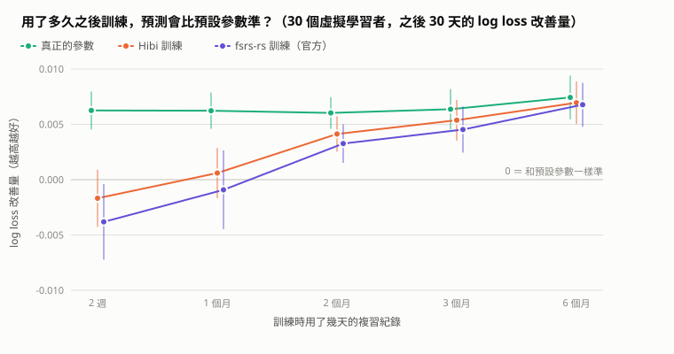
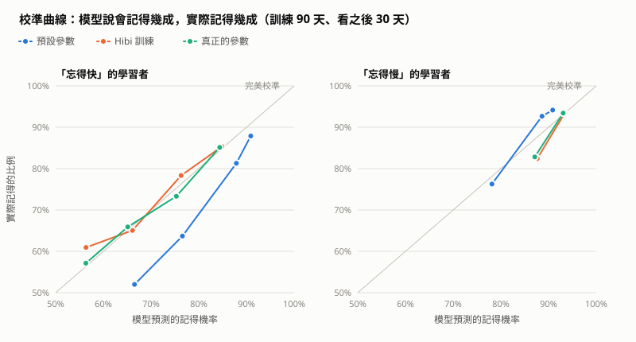

# 實驗報告：用自己的複習紀錄訓練 FSRS 參數，要累積多少才划算？

> 2026 年 11 月。所有數字都可以用 `npm run experiment` 重新產生（約 2 分鐘，結果完全相同），原始數據在 [`docs/experiment/results.json`](experiment/results.json)。

## 白話摘要

Hibi 用 FSRS 演算法預測「你現在還記不記得這張卡」。演算法有 21 個參數，App 用的是官方從大量 Anki 使用者算出來的**預設值**。
每個人忘記的速度不一樣，所以理論上可以用自己的複習紀錄**重新訓練**參數。但紀錄太少時，訓練可能只學到雜訊，反而變差。

這個實驗用 33 個「虛擬學習者」回答：**要用多久的 App，訓練出來的參數才會比預設值準？**

- **2 週**（約 190 次複習）：訓練沒有幫助，平均甚至略差；30 人裡只有 13 人變好。
- **1 個月**（約 600 次）：和預設差不多，一半的人變好、一半變差。
- **2 個月**（約 1,700 次）：開始穩定變好，30 人裡 26 人變好，拿到理論上最大改善的 68%。
- **6 個月**（約 8,000 次）：30 人全部變好，拿到理論上最大改善的 94%。

另外兩個結果：

- Hibi 自己寫的訓練程式，和 FSRS 官方的訓練程式（fsrs-rs，Anki 內建的就是它）效果相當，在 2、3 個月時還略好一些（原因和限制見 3.4）。
- 評估程式和官方完全一致：同一組參數、同樣的資料，算出來的誤差和官方程式相差不到 0.000001。

**對 App 的建議**：至少累積約 2 個月（1,500 次以上隔天的複習）再提供「用我的紀錄訓練」；訓練完要先用最近 30 天的紀錄檢查，確定比預設準才套用。

**最重要的限制**：這是模擬資料。虛擬學習者的記憶「剛好就是」照 FSRS 模型運作，真人不是。這個實驗證明的是「訓練方法有效、多少資料才夠」，不是「對真人一定有效」。

---

## 1. 問題

FSRS 對每次複習預測一個「記得的機率」R。預測準不準，直接影響排程：高估了，卡片會在你已經忘記之後才出現；低估了，會浪費時間複習還記得的卡。

預設參數是很多人的平均。對「忘得特別快」的人，預設參數會一直高估他記得的機率。用自己的紀錄重新訓練可以修正這點，但有兩個風險：

1. 紀錄太少時，訓練會配合到資料裡的偶然結果（**過度擬合**），對未來的預測反而變差。
2. 自己寫的訓練程式可能有錯，而且錯了也不一定看得出來。

所以這個實驗要回答兩個問題：(1) 要多少紀錄，訓練才划算？(2) Hibi 的訓練程式做得對不對、跟官方比起來如何？

## 2. 方法

### 2.1 虛擬學習者

每個虛擬學習者有一組**真正的參數**，代表他的大腦實際上怎麼遺忘，但 App 不知道。模擬時（`src/core/learner.ts`）：

- **App 端**：用和真正 App 完全相同的排程程式（`scheduler.ts`），一律用**預設參數**決定每張卡什麼時候出現。
- **學習者端**：每次複習時，用他**真正的參數**算出此刻記得的機率，擲骰子決定記不記得。
  - 記得的話，再依官方模擬器的機率決定評「困難／記得／簡單」（22.4%／63.1%／14.5%）。
  - 新卡第一次看到時，評分機率也用官方模擬器的預設值（重來 24%、困難 9.4%、記得 49.5%、簡單 17.1%）。這些數字是從 Anki 使用者資料統計來的。

每個人模擬學習 **210 天**：每天晚上 9 點加入 10 張新卡，把到期的卡複習完。

學習者有兩種：

| 類型 | 人數 | 真正的參數 |
| --- | ---: | --- |
| 代表性的人 | 3 | **平均型**：就是預設值（對照組）<br>**忘得快**：初始穩定度只有預設的 35%，答對後穩定度成長較慢，忘記後重建也較慢<br>**忘得慢**：初始穩定度是預設的 2.5 倍，答對後穩定度成長較快 |
| 隨機抽樣的人 | 30 | 以預設值為中心抽樣。初始穩定度（w0～w3）乘上 e^N(0, 0.5)；其他參數加上「0.5 × 官方統計的使用者間標準差 × 標準常態亂數」，再限制在合法範圍內 |

隨機的 30 人用來算平均和信賴區間，代表性的 3 人用來看具體發生了什麼事。

### 2.2 訓練集與測試集

模擬「用了 k 天之後按下訓練」：

- **訓練**：只用前 k 天的紀錄，k = 14、30、60、90、180。
- **測試**：看接下來 30 天，預測準不準。

訓練時完全看不到測試期間的資料。評估的對象和官方一樣：**不是卡片的第一次、而且隔了至少一天**的複習。同一天內的學習步驟（1 分、10 分鐘）不計分，但會照樣更新記憶狀態。

### 2.3 Hibi 的訓練程式（`src/core/optimize.ts`）

| 項目 | 做法 | 和官方相同？ |
| --- | --- | --- |
| 目標 | 平均 log loss ＋ 懲罰項 γ/n · Σ((wᵢ − 預設ᵢ)/標準差ᵢ)²，γ = 1 | 相同（官方 fsrs-optimizer 6.x 的設計） |
| 參數範圍 | 每一步後夾回合法範圍 | 相同（官方 ParameterClipper 的數值） |
| 梯度 | 前向模式自動微分（`src/core/autodiff.ts`），重播一次紀錄就得到 21 個偏微分 | 官方用 PyTorch／Burn 的反向模式自動微分 |
| 最佳化 | Adam，學習率 0.04、餘弦遞減，每一步用全部資料，共 100 步 | 官方分小批次（512 筆），5 輪 |
| 初始穩定度 w0～w3 | 在對數尺度上調整 | 官方另外先用第一次複習的結果估計 |
| 資料加權 | 每筆一樣重要 | fsrs-rs 給越新的資料越高的權重（fsrs-optimizer 是選項） |

正確性檢查（`optimize.test.ts`）：

- 可微分版本算出的 log loss，和 App 實際使用的 `fsrs.ts` 相差小於 10⁻⁶。
- 21 個梯度都和有限差分一致（每個參數各加減一點點、重算）。
- 用預設參數重播紀錄，每一次的預測都和 App 當時記下的值完全相同。

速度：在電腦上，3 個月的紀錄（約 4,000 次評分）訓練約 1 秒，6 個月的紀錄約 2.5 秒。

### 2.4 比較的四組參數

| 名稱 | 說明 |
| --- | --- |
| 預設參數 | App 現在用的 |
| Hibi 訓練 | 用 Hibi 的訓練程式、只看前 k 天訓練出來的 |
| fsrs-rs 訓練 | 用官方訓練程式 fsrs-rs 6.6.2（透過 fsrs-rs-python 0.9.3）、同樣的資料訓練出來的 |
| 真正的參數 | 學習者真正的參數。現實中不可能知道，代表**理論上的最好表現** |

### 2.5 指標（`src/core/calibration.ts`）

- **log loss**：預測和結果的差距，越小越好。主要指標，表格裡報告的是「預設參數的 log loss − 這組參數的 log loss」，**正數代表比預設準**。
- **校準誤差**：把預測值分成 10 組（0～10%、10～20%……），每組比較「平均預測」和「實際記得的比例」，再算加權均方根，越小越好。
- **AUC**：隨機挑一次記得、一次忘記的複習，模型給「記得」那次比較高預測值的機率。0.5 是亂猜。

30 個隨機學習者的結果報告平均值和 95% 信賴區間（t 分布，自由度 29）。

### 2.6 和官方程式的一致性檢查

為了確定「Hibi 挑出來的測試資料、算出來的預測值」和官方完全一樣，每一次實驗（33 人 × 5 種 k）都用官方程式的 `evaluate` 重算一次 log loss。官方的 evaluate 會依資料順序加權，越新的權重越高，第 i 筆是 0.25 + 0.75·(i/(n−1))³，所以這裡用同樣的加權來比。

結果：165 次實驗、每次三組參數，**最大差異 7.2 × 10⁻⁷**，只是浮點數精度的差別。

## 3. 結果

### 3.1 要累積多少紀錄？



30 個隨機學習者，比預設參數改善多少 log loss（正數＝比較準；括號是 95% 信賴區間）：

| 訓練用的紀錄 | 訓練筆數（平均） | Hibi 訓練 | 變好的人 | fsrs-rs 訓練 | 變好的人 | 真正的參數（上限） |
| --- | ---: | --- | ---: | --- | ---: | --- |
| 2 週 | 185 | -0.0017（-0.0043 ~ +0.0009） | 13/30 | -0.0038（-0.0072 ~ -0.0004） | 11/30 | +0.0063（+0.0045 ~ +0.0080） |
| 1 個月 | 613 | +0.0006（-0.0017 ~ +0.0029） | 15/30 | -0.0009（-0.0045 ~ +0.0026） | 17/30 | +0.0062（+0.0046 ~ +0.0079） |
| 2 個月 | 1,693 | +0.0041（+0.0025 ~ +0.0057） | 26/30 | +0.0033（+0.0015 ~ +0.0050） | 20/30 | +0.0060（+0.0046 ~ +0.0075） |
| 3 個月 | 3,036 | +0.0054（+0.0035 ~ +0.0072） | 24/30 | +0.0045（+0.0024 ~ +0.0066） | 22/30 | +0.0064（+0.0045 ~ +0.0082） |
| 6 個月 | 8,035 | +0.0070（+0.0050 ~ +0.0089） | 30/30 | +0.0068（+0.0048 ~ +0.0088） | 30/30 | +0.0074（+0.0055 ~ +0.0094） |

怎麼讀這張表：

- **2 週和 1 個月**：信賴區間包含 0，代表看不出有幫助。官方程式在 2 週時甚至顯著變差，信賴區間整個在 0 以下。
- **2 個月起**：信賴區間整個在 0 以上，穩定變好。Hibi 訓練拿到理論上限的比例：2 個月 68%、3 個月 84%、6 個月 94%。
- 改善量看起來很小（0.004～0.007），是因為**理論上限本身就只有約 0.006～0.007**：這 30 人是從「預設值附近」抽樣的，本來就和預設差不多。換成比較直觀的校準誤差（3.3），6 個月時從 0.028 降到 0.016，少了四成多。

### 3.2 具體的例子：「忘得快」和「忘得慢」



訓練 3 個月後，看接下來 30 天：

| 學習者 | 訓練筆數 | 測試筆數 | 預設參數 | Hibi 訓練 | fsrs-rs 訓練 | 真正的參數 |
| --- | ---: | ---: | --- | --- | --- | --- |
| 平均型 | 3,218 | 1,719 | 0.3774／0.022 | 0.3791／0.025 | 0.3776／0.021 | 0.3774／0.022 |
| 忘得快 | 4,210 | 2,342 | 0.4741／0.067 | 0.4582／0.017 | 0.4584／0.021 | 0.4582／0.015 |
| 忘得慢 | 2,815 | 1,393 | 0.2639／0.038 | 0.2578／0.020 | 0.2587／0.014 | 0.2556／0.014 |

（每格是 log loss／校準誤差，兩者都是越小越好）

- **忘得快**：預設參數一直高估。它預測 88% 會記得的那 1,315 次複習，實際只記得 81%；預測 77% 的那 190 次，實際只有 64%。
  訓練後預測 85% 的那組，實際就是 85%。校準誤差從 0.067 降到 0.017，log loss 和真正的參數一樣。
- **忘得慢**：反過來，預設參數低估他記得的機率。訓練後同樣修正了大部分。
- **平均型（對照組）**：真正的參數就是預設值，所以預設已經是最好的，訓練只會帶來雜訊。
  每一種 k 訓練後都略差：

  | 訓練用的紀錄 | 2 週 | 1 個月 | 2 個月 | 3 個月 | 6 個月 |
  | --- | ---: | ---: | ---: | ---: | ---: |
  | Hibi 訓練 − 預設 | +0.0044 | +0.0034 | +0.0024 | +0.0017 | +0.0013 |
  | fsrs-rs 訓練 − 預設 | +0.0076 | +0.0035 | +0.0035 | +0.0002 | +0.0029 |

  這裡正數代表**變差**。資料越多，變差得越少。這說明個人化有成本：如果你本來就跟平均差不多，訓練不一定划算。

### 3.3 校準誤差和 AUC

30 個隨機學習者的平均校準誤差（越小越好）：

| 訓練用的紀錄 | 預設參數 | Hibi 訓練 | fsrs-rs 訓練 | 真正的參數 |
| --- | ---: | ---: | ---: | ---: |
| 2 週 | 0.030 | 0.030 | 0.038 | 0.020 |
| 1 個月 | 0.030 | 0.030 | 0.032 | 0.021 |
| 2 個月 | 0.027 | 0.020 | 0.022 | 0.017 |
| 3 個月 | 0.029 | 0.019 | 0.021 | 0.017 |
| 6 個月 | 0.028 | 0.016 | 0.014 | 0.015 |

平均 AUC（越大越好）：

| 訓練用的紀錄 | 預設參數 | Hibi 訓練 | fsrs-rs 訓練 | 真正的參數 |
| --- | ---: | ---: | ---: | ---: |
| 2 週 | 0.582 | 0.580 | 0.576 | 0.621 |
| 1 個月 | 0.572 | 0.587 | 0.588 | 0.613 |
| 2 個月 | 0.579 | 0.609 | 0.606 | 0.623 |
| 3 個月 | 0.577 | 0.611 | 0.606 | 0.620 |
| 6 個月 | 0.566 | 0.611 | 0.609 | 0.614 |

即使用真正的參數，AUC 也只有約 0.62。單次複習本來就有很大的隨機性（擲骰子），任何模型都不可能完全預測。

### 3.4 Hibi 的訓練程式 vs. 官方 fsrs-rs

兩者在同一份資料上的 log loss 差（負數＝Hibi 比較準）：

| 訓練用的紀錄 | Hibi − fsrs-rs |
| --- | --- |
| 2 週 | -0.0021（-0.0049 ~ +0.0006） |
| 1 個月 | -0.0015（-0.0035 ~ +0.0005） |
| 2 個月 | -0.0009（-0.0014 ~ -0.0003） |
| 3 個月 | -0.0008（-0.0014 ~ -0.0003） |
| 6 個月 | -0.0002（-0.0004 ~ +0.0001） |

在 2、3 個月時，Hibi 的訓練程式顯著比較準；6 個月時兩者沒有差別。

**不能因此說 Hibi 的訓練程式比官方好。** 最可能的原因是資料加權。fsrs-rs 給越新的資料越高的權重（把同一份訓練資料順序倒過來，它訓練出的參數就會不同，可以確認這點），這是假設「人會變」：會進步、會換學習方法。這個模擬裡的虛擬學習者從頭到尾都不會變，所以舊資料和新資料一樣有用，降低舊資料的權重等於丟掉資訊。真人會變，官方的設計在真實資料上可能才是對的。

這裡能確定的是：**Hibi 的訓練程式做的事是對的，效果和官方相當。**

## 4. 討論：對 App 的建議（第二步的設計依據）

1. **門檻**：累積約 2 個月、1,500 次以上「隔天以後」的複習，才提供「用我的紀錄訓練」。
   門檻用複習次數而不是天數，因為每個人每天的量不同。2 個月時 30 人中有 26 人變好、平均拿到上限的 68%。
2. **先驗證再套用**：訓練時保留最近 30 天當測試集，比較訓練後和預設參數的 log loss，**比較準才套用**，否則維持預設。
   這可以避開「平均型」那種越訓練越差的情況。驗證完再用全部資料重新訓練一次。
3. **讓使用者看得懂**：顯示訓練前後的校準曲線（像 3.2 的圖），比顯示 log loss 數字直觀。
4. **在手機上訓練可行**：電腦上 6 個月的紀錄約 2.5 秒。手機慢幾倍也在可接受範圍，訓練時顯示進度條。

## 5. 限制

1. **模擬資料，模型完全正確**：虛擬學習者的記憶就是照 FSRS 公式運作，這是對訓練方法最有利的情況。真人的記憶不完全符合 FSRS，改善幅度可能比較小，需要的資料量也可能不同。
2. **學習者不會改變**：真人會進步、會偷懶、會考前衝刺。這也是 3.4 兩個訓練程式差異的可能原因。
3. **行為簡化**：每天固定 10 張新卡、天天複習、評分機率固定。真實使用者會中斷好幾天，評分習慣也因人而異。
4. **學習者的分布是假設的**：30 人是從「預設值 ± 一半的官方標準差」抽樣，真實使用者的差異可能更大，那樣個人化的好處也會更大。
5. **只比了 log loss 這類預測指標**：預測更準，排程是否真的讓人記得更多、複習得更少，需要另外模擬「用訓練後的參數排程」才知道。

**下一步**：在 App 加入訓練功能（第二步）。之後如果能取得真人資料（例如找同學使用，在同意與匿名化之後），就能用同樣的流程驗證限制 1、2。

## 6. 重現方式

```bash
npm install
pip install fsrs-rs-python   # 選用：沒裝的話會略過官方對照
npm run experiment           # 約 2 分鐘；固定亂數種子，每次結果相同
```

| 檔案 | 內容 |
| --- | --- |
| `src/core/optimize.ts` | 訓練程式：整理紀錄、重播預測、可微分的 FSRS-6、Adam |
| `src/core/autodiff.ts` | 前向模式自動微分 |
| `src/core/calibration.ts` | log loss、校準曲線、校準誤差、AUC |
| `src/core/learner.ts` | 虛擬學習者與模擬 |
| `src/core/*.test.ts` | 對應的單元測試 |
| `scripts/experiment.ts` | 實驗流程、統計、畫圖 |
| `scripts/fsrs_rs_reference.py` | 呼叫官方 fsrs-rs 訓練與評估 |
| `docs/experiment/` | 結果（results.json）與兩張圖 |

## 參考資料

- FSRS 演算法說明：https://github.com/open-spaced-repetition/awesome-fsrs/wiki/The-Algorithm
- fsrs-rs（官方 Rust 實作，Anki 內建）：https://github.com/open-spaced-repetition/fsrs-rs
- fsrs-optimizer（官方 Python 訓練程式；參數範圍、標準差、懲罰項的來源）：https://github.com/open-spaced-repetition/fsrs-optimizer
- SRS 演算法評測（log loss、RMSE 等指標）：https://github.com/open-spaced-repetition/srs-benchmark
- Kingma, D. P., & Ba, J. (2015). Adam: A Method for Stochastic Optimization. ICLR. https://arxiv.org/abs/1412.6980
